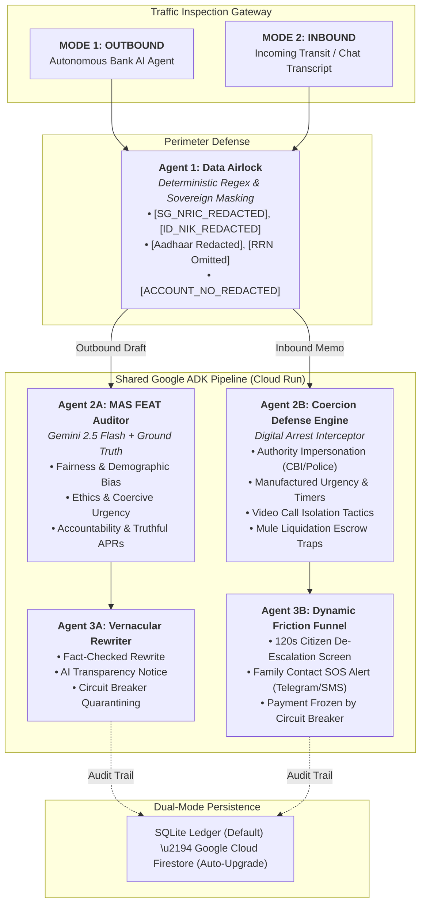

# VeriBrake A2A: Unified Bidirectional Enterprise Risk & Compliance Mesh
**Official Entry for Google Cloud AI Builder Cup (JAPAC Region)**

[](https://cloud.google.com/run)
[](https://ai.google.dev/)
[](https://a2a-protocol.org)
[](https://fastapi.tiangolo.com)
[](https://vitejs.dev)
[](LICENSE)

---


# 🛡️ VeriBrake A2A
### Autonomous Bidirectional Enterprise Risk & Compliance Mesh for JAPAC BFSI

[](https://veribrake-a2a-2026.web.app/)
[](https://veribrake-a2a-api-551328304849.asia-southeast1.run.app/.well-known/agent.json)
[-FF0000?style=for-the-badge&logo=youtube&logoColor=white)](https://youtu.be/7_N2WR5NRsw)
[](./LICENSE)

---

## 💡 The Inspiration: Why We Built "VeriBrake"

Our architecture was born from two foundational industry truths that define the 2026 Agentic AI era:

> **1. The High-Speed Brake Paradox (Why We Named It *VeriBrake*)**  
> *"It is amazing how many drivers, even at the Formula One level, think that the brakes are for slowing the car down."* — **Mario Andretti**, Formula 1 World Champion  
>   
> As highlighted in **McKinsey & Company’s *State of AI in Southeast Asia*** and **KPMG’s *Trust in AI* Governance Frameworks**, **41% of enterprises** have suffered negative consequences from AI inaccuracy, causing **82% of bank risk teams** to block customer-facing AI deployments. Cars do not have brakes to go slow—they have brakes so they can **drive at 200 mph safely**. **VeriBrake** is that verifiable, sub-2-second safety brake for enterprise banking AI.

> **2. The "Mind & Hand" Agentic Problem Statement**  
> *"The era of AI that doesn't just talk, but acts, creates, and delivers, is only beginning."* — **Xiao Hong**, Founder & CEO of **Manus AI** (*Mens et Manus* — "Mind and Hand")  
>   
> As AI evolves from conversational chatbots (*Mind*) into autonomous agents that execute transactions and trigger APIs (*Hand*), enterprises face a dual crisis: **What stops an outbound bank agent from hallucinating an illegal financial contract or leaking cross-border PII?** And **what stops an inbound human customer from being coerced by a 'Digital Arrest' scammer into draining their life savings?**  
> Answering **Google Cloud APAC President Karan Bajwa’s** call for open agent interoperability, we built **VeriBrake A2A**—an open Agent2Agent (`/.well-known/agent.json`) circuit breaker positioned directly between the AI’s *Mind* and the bank’s *Hand*.

---

## 1. Executive Summary

As financial institutions across JAPAC (Singapore, India, Indonesia, Malaysia, Thailand, Australia) confront the dual perils of **autonomous generative AI hallucinations** and **hyper-engineered cyber-extortion scams**, legacy single-direction filters fail:
1. **Outbound Risk**: Autonomous banking agents hallucinate non-existent APR rates, discriminate based on demographic attributes, and leak confidential citizen identifiers (NRIC, NIK, Aadhaar) across sovereign borders.
2. **Inbound Risk**: Citizens lose life savings to psychological coercion syndicates executing **"Digital Arrests"** (fake CBI, police, customs, or court escrow demands) and courier contraband extortion traps.

**VeriBrake A2A** solves both threats through a **unified, bidirectional Enterprise Risk & Compliance Mesh** operating over a shared Google ADK pipeline with sub-second execution latency.

---

## 2. Bidirectional Architecture



---

## 3. Workflow Modes

### Mode 1: Outbound Enterprise AI Governance (MAS FEAT Safety Brake)
- **Agent 1 (Data Airlock)**: Scrubs national identifiers before messages cross sovereign boundaries.
- **Agent 2 (MAS FEAT & Veritas Auditor)**: Fact-checks against official bank products in `ground_truth.json` (e.g. 4.5% minimum loan APR) and evaluates the 4 MAS Veritas pillars:
  1. **Fairness**: Neutrality across demographic attributes (gender, location, postal code).
  2. **Ethics**: Elimination of coercive sales countdowns and deceptive claims.
  3. **Accountability**: Immutable audit logs and human escalation ownership.
  4. **Transparency**: Mandatory disclosure of AI involvement and accurate terms.
- **Agent 3 (Vernacular Rewriter & Circuit Breaker)**: Auto-rewrites unsafe drafts (score 36–75) or trips the Circuit Breaker (score 76–100).

### Mode 2: Inbound Psychological Coercion & Fraud Defense (Digital Arrest Interceptor)
- **Agent 1 (Data Airlock)**: Strips citizen account credentials and police impostor tokens.
- **Agent 2 (Coercion Defense Engine)**: Analyzes extortion syntax across 4 psychological vectors:
  1. **Authority Impersonation** (Fake CBI, Cyber Crime, Supreme Court, Customs).
  2. **Manufactured Urgency** (15-minute liquidation timers, immediate raid threats).
  3. **Isolation Coercion** (Forbidding disconnecting Skype calls or informing family).
  4. **Mule Liquidation Risk** (Transfers to "verification escrow" or "clearance deposits").
- **Agent 3 (Dynamic Friction & SOS Dispatch)**:
  - If score $\ge 75$: Engages **Circuit Breaker Freeze**, halts payment routing, renders a soothing **Citizen De-escalation Screen (120s cooldown)**, and dispatches an immediate **SOS Webhook Alert** to the customer's registered emergency family contact.

---

## 4. Agent2Agent (A2A) Protocol Specification

Exposed at `GET /.well-known/agent.json`, the A2A Agent Card publishes dual capabilities:

```json
{
  "$schema": "https://a2a-protocol.org/schemas/v1/agent-card.json",
  "protocol_version": "0.4.0",
  "agent_id": "veribrake-japac-bidirectional-guardrail-mesh",
  "capabilities": {
    "autonomous_interception": true,
    "bidirectional_inspection": true,
    "governance.mas_feat_auditing": true,
    "fraud.psychological_coercion_interception": true,
    "dynamic_friction_injection": true,
    "circuit_breaker": true
  },
  "supported_frameworks": [
    { "id": "MAS_FEAT", "pillars": ["Fairness", "Ethics", "Accountability", "Transparency"] },
    { "id": "I4C_DIGITAL_ARREST", "scope": "Inbound Video Extortion & Escrow Defense" },
    { "id": "ID_GR71", "scope": "Data Residency and NIK Identification Protection" },
    { "id": "IN_DPDP", "scope": "Aadhaar Masking & Purpose Limitation" }
  ]
}
```

---

## 5. Instant Benchmark Scenarios

| # | Mode | Scenario Name | Primary Vulnerability | Verdict | Key Guardrail Activated |
|---|---|---|---|---|---|
| **1** | **OUTBOUND** | **Hallucinated Rate & PII Leak** | 0% APR hallucination & NIK `3171012803890005` leaked | `BLOCKED_ESCALATED` | NIK redacted to `[ID_NIK_REDACTED]`, Indonesia GR 71 cited, Circuit Breaker engaged |
| **2** | **OUTBOUND** | **MAS FEAT Demographic Bias** | Female credit limit capped based on gender & postal code | `BLOCKED_ESCALATED` | MAS FEAT Fairness breach flagged, NRIC masked, unbiased rewrite generated |
| **3** | **INBOUND** | **Digital Arrest - Fake CBI Extortion** | Fake CBI Skype interrogation demanding ₹5,00,000 to escrow | `CIRCUIT_BREAKER_FROZEN` | 95/100 Coercion severity, Payment frozen, 120s Citizen Calm Card rendered, Family SOS alert dispatched |
| **4** | **INBOUND** | **Courier Narcotic Scam** | DHL/FedEx seizure threat demanding $2,500 clearance deposit | `CIRCUIT_BREAKER_FROZEN` | Authority impersonation flagged, mule account quarantined, Hotline 1930 referenced |
| **5** | **OUTBOUND** | **100% Compliant SME Advisory** | Accurate 4.5% financing with full Veritas AI disclosure | `APPROVED` | Clean pass, zero redactions needed, sub-200ms latency |

---

## 6. Quickstart & Deployment

### Run Locally
```bash
# Terminal 1: Backend
cd backend
uv venv .venv --python 3.11
.venv/Scripts/activate  # On Unix: source .venv/bin/activate
uv pip install -r requirements.txt
uvicorn app.main:app --host 127.0.0.1 --port 8080 --reload

# Terminal 2: Frontend
cd frontend
npm install
npm run dev
```

### Cloud Run & Firebase Deployment
```bash
# Backend to Cloud Run
cd backend
gcloud run deploy veribrake-backend \
  --source . \
  --region asia-southeast1 \
  --allow-unauthenticated \
  --set-env-vars GOOGLE_CLOUD_PROJECT=$GOOGLE_CLOUD_PROJECT

# Frontend to Firebase Hosting
cd frontend
npm run build
firebase deploy --only hosting
```

---

*Built with ❤️ for the Google Cloud AI Builder Cup (JAPAC Region).*
